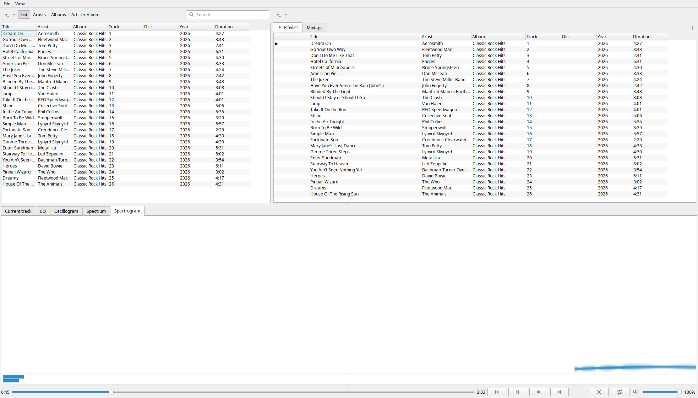
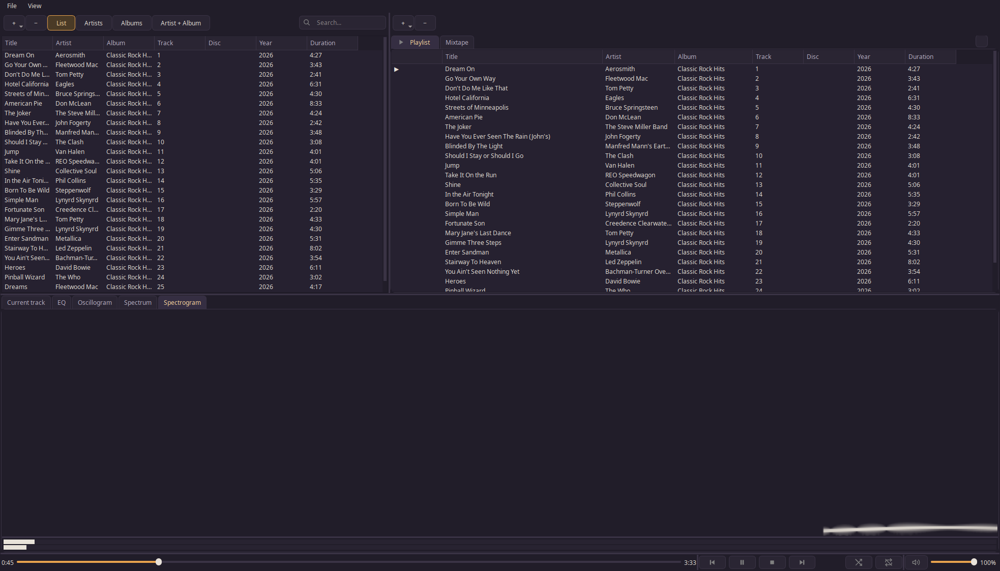
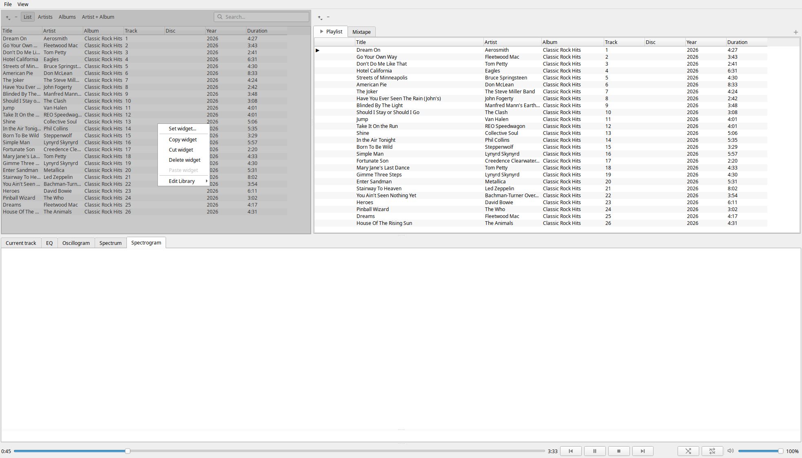
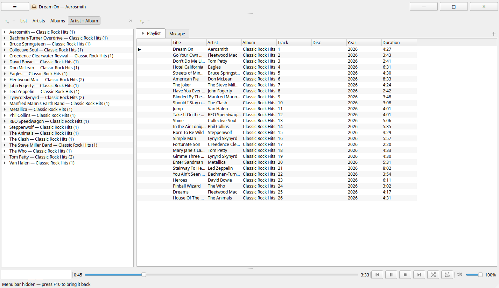
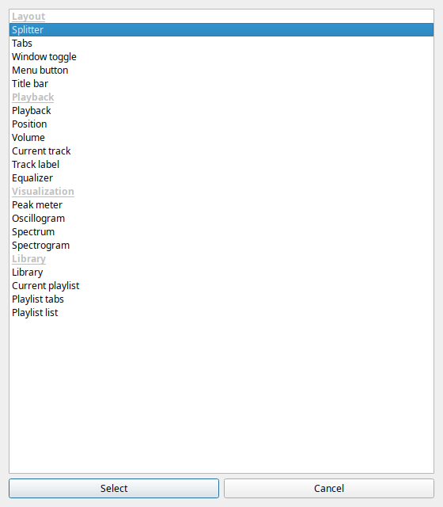
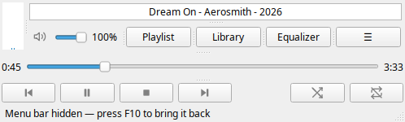

# doob

A modular desktop audio player. The interface is a composition of composable
widgets — library, playlists, current track, equalizer, oscilloscope,
spectrum, spectrogram — arranged by you in splits, tabs and multiple
windows, and saved per layout name. Playback is plugin-driven: a built-in
null driver (it plays nothing, on purpose) plus bundled plugins for an
FFmpeg-based player (PulseAudio/PipeWire output, with an equalizer/DSP
chain), a capture-based Spotify source and a YouTube Music source.

## Gallery

| | |
|---|---|
|  |  |
|  |  |
|  |  |

More shots, including the other layout/style combinations and dialogs, in
[`gallery/`](gallery/).

## Building

```
cmake -S . -B build
cmake --build build
```

The app is `build/doob`; it links against `doob_lib`, the same shared
library the plugins are built against.

## Dependencies

- CMake ≥ 3.16, a C++17 compiler
- Qt 5 or Qt 6 — Widgets, Sql, Svg, Network, DBus (plus Test for the suite)
- TagLib
- Optional, for the FFmpeg player plugin: FFmpeg (libavformat, libavcodec,
  libavutil, libswresample) and libpulse — absent, the plugin is skipped at
  configure time
- Optional, for the Spotify plugin: libpulse / libpulse-simple
- The tubemusic plugin shells out to `yt-dlp` at runtime

## Tests

```
ctest --test-dir build --output-on-failure
```

## Command line

```
doob [--play] [--new] [--name <name>] [sources...]
```

The positional sources (files, playlist files, URLs) are imported on start;
a second `doob` invocation forwards its command line to the running
instance and exits — the "play with doob" / "append to playlist" use.

## AppImage

`packaging/appimage/build.sh` builds a distributable, self-contained image
with the FFmpeg and Spotify plugins fully bundled. The whole pipeline runs
in the digest-pinned `fedora:42` build image (the distro's Qt 6.10.2 —
Spotify playback needs a WebEngine with AAC-MSE, which the aqt-built Qt
does not have): compile, the default test gate, assemble the AppDir,
bundle the dependency closure, package.

```
packaging/appimage/build.sh                 # -> a fresh /tmp/doob-appimage.*/out/
packaging/appimage/build.sh --sign KEYID    # + the GPG signature (embedded + .asc)
```

Same source + base image digest + tool hash gives the bit-for-bit same
artifact; the steps and the reproducibility details are commented in
`build.sh`.

## Layouts, styles, plugins

Bundled layout presets (classic, compact, kiosk) and style presets
(default, dawn, dusk, matrix, terminal) live in `presets/`; your own layouts
and styles are stored per name alongside them (see
[`docs/persistence.md`](docs/persistence.md)). Plugins are `.so` libraries
loaded at runtime — the spec and the ABI are in
[`docs/plugins.md`](docs/plugins.md).

## License

MIT — see [LICENSE](LICENSE).
